# AlphaZero Connect Four

A complete AlphaZero-style Connect Four project: PUCT Monte Carlo tree search, a residual
policy-value network, self-play data generation, replay-buffer training, gated arena evaluation,
checkpoints, TensorBoard metrics, a command-line interface, and a Pygame desktop client.

The included `demo` experiment was trained from randomly initialized weights on this machine.
Every number, chart, log, and screenshot in this README was produced by the code in this
repository. There are no pretrained weights, hand-written training targets, or fabricated results.

## Screenshots

| Main menu | Human vs AI |
| --- | --- |
| 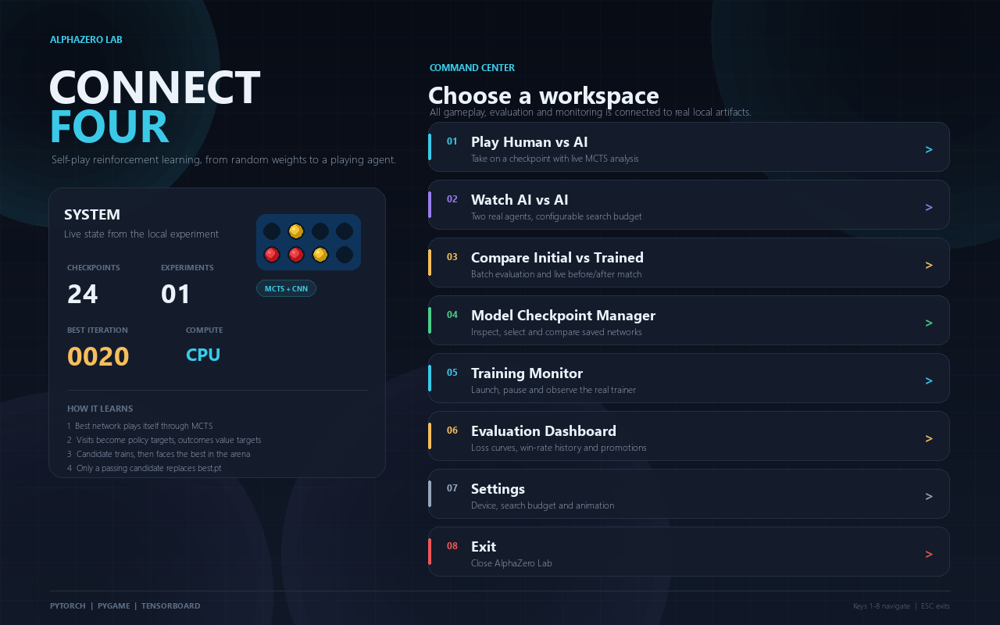 | 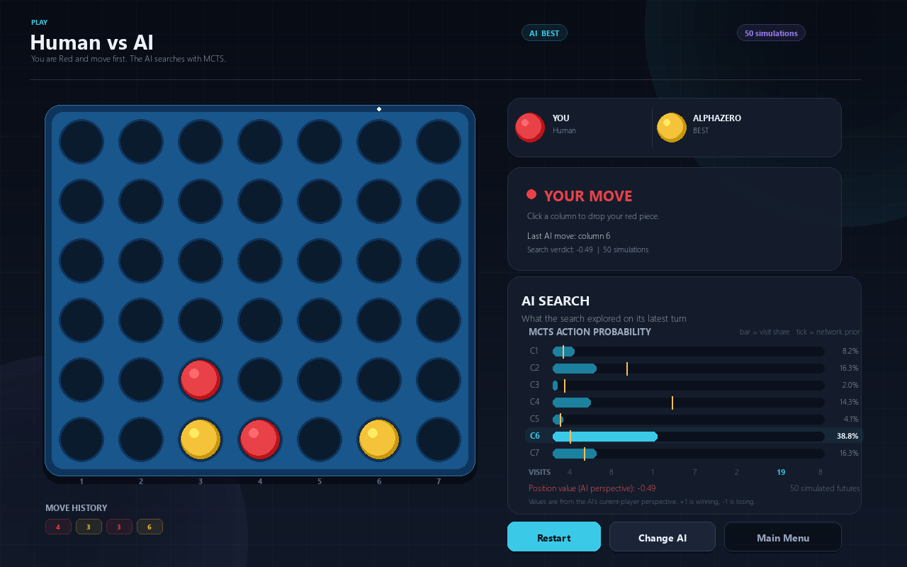 |

| AI vs AI | Initial vs trained |
| --- | --- |
| 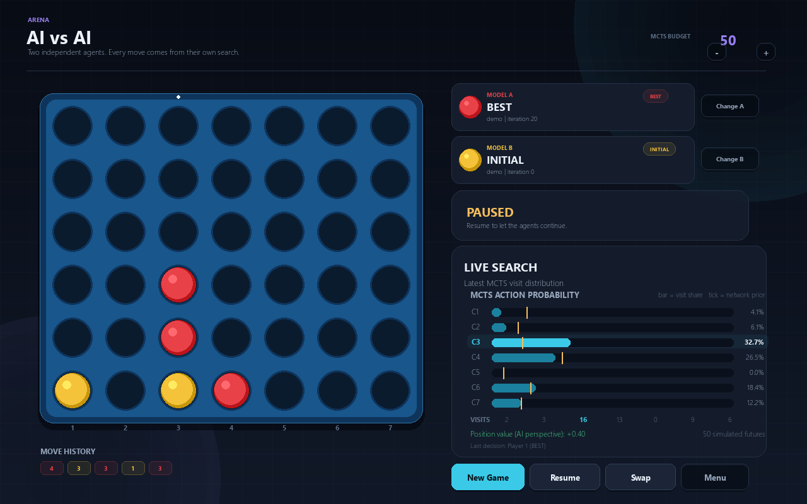 | 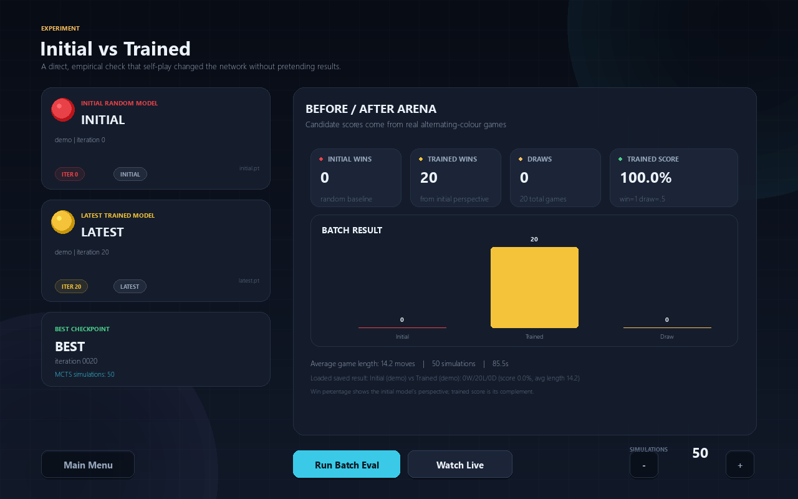 |

| Training monitor | Evaluation dashboard |
| --- | --- |
| 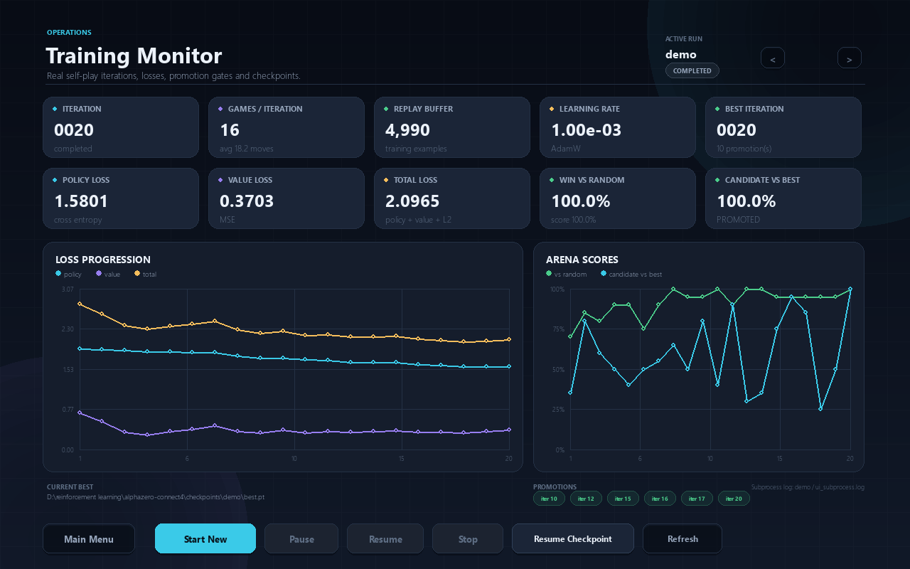 | 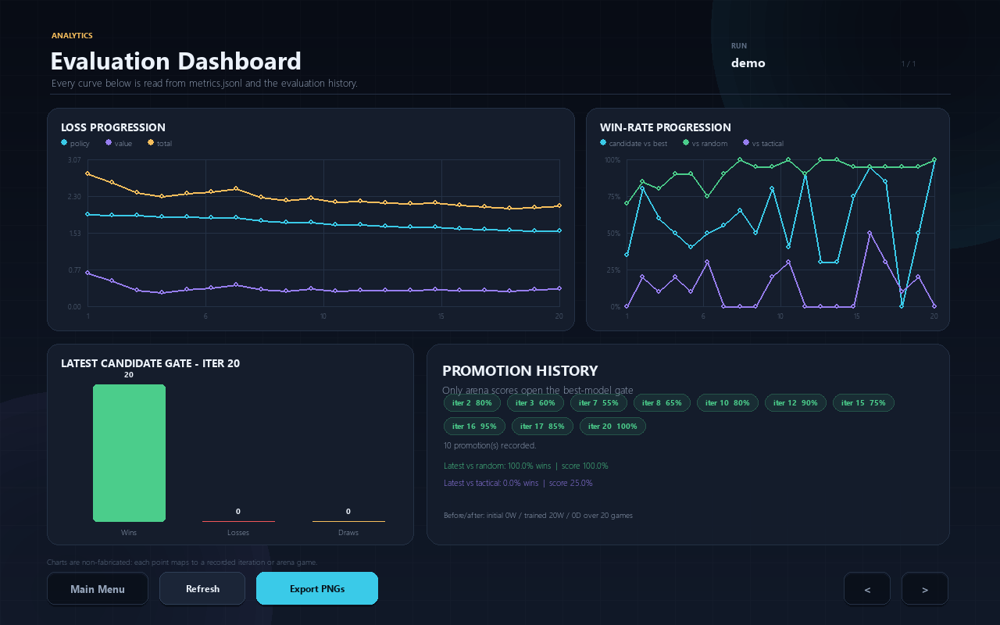 |

| Checkpoint manager | Settings |
| --- | --- |
| 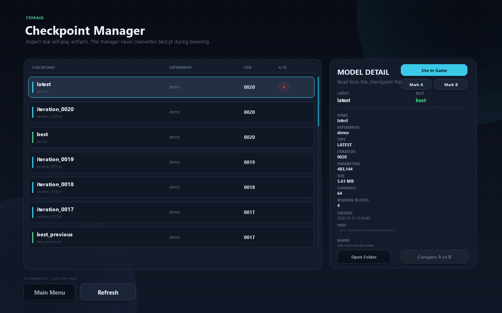 | 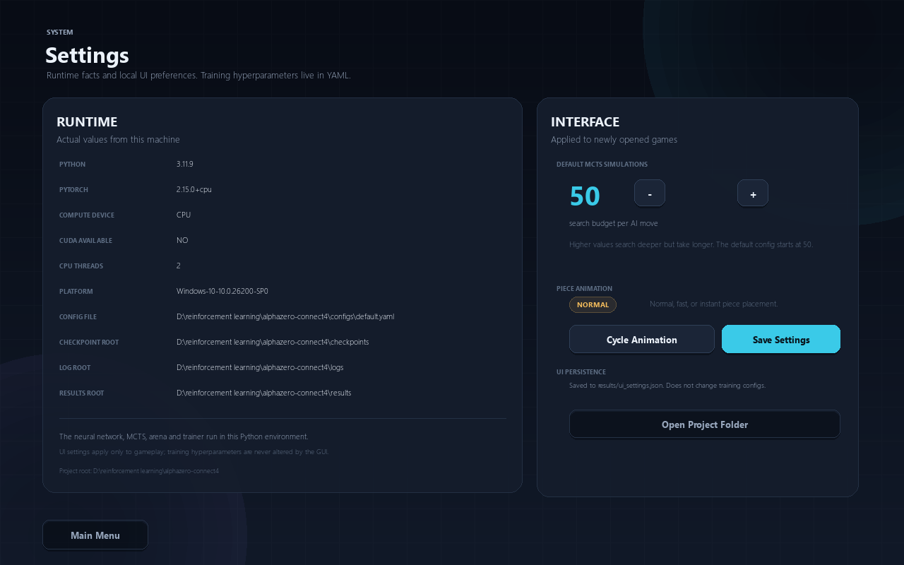 |

## What Is Implemented

- Correct Connect Four engine with legal moves, gravity, win detection, winning lines, draws,
  cloned states, and current-player observations.
- Residual convolutional policy-value network with separate policy and value heads.
- PUCT MCTS with neural leaf evaluation, Dirichlet root noise for self-play, visit-count policy,
  temperature-controlled opening moves, and current-player-relative values.
- Self-play generation with persistent examples, threaded game collection, and optional process
  workers.
- Circular replay buffer, policy cross-entropy, value MSE, L2 regularization, gradient clipping,
  and AdamW.
- Iterative training where each candidate starts from the current best network.
- Arena evaluation against the current best, random agent, and tactical baseline.
- Promotion only after a real arena result crosses the configured threshold.
- Atomic best-checkpoint replacement with a `best_previous.pt` backup.
- Resume support for model, optimizer, scheduler, replay buffer, iteration, and evaluation history.
- JSONL metrics, status/control files, training logs, TensorBoard event files, and Matplotlib reports.
- Pygame GUI with:
  - Human vs AI and live MCTS action probabilities.
  - AI vs AI with independent models, search budget, pause, and color swap.
  - Initial-vs-trained batch evaluation and live match.
  - Checkpoint browsing, A/B marks, and model selection.
  - Training monitor that launches the real trainer as a subprocess and supports pause/resume/stop.
  - Evaluation dashboard with real loss curves, arena history, gate results, and promotions.
  - UI settings persisted to `results/ui_settings.json`.

## Project Layout

```text
alphazero-connect4/
|-- game/                Connect Four rules and observations
|-- mcts/                PUCT nodes and search
|-- model/               Residual network and checkpoint utilities
|-- selfplay/            Self-play generation and workers
|-- training/            Replay buffer, losses, iterative trainer
|-- evaluation/          Arena, baselines, metrics, reporting
|-- visualization/       Pygame app, screens, and reusable components
|-- configs/             default and CPU demo configurations
|-- scripts/             report generation and screenshot capture
|-- tests/               core, reporting, and headless UI tests
|-- train.py             training entry point
|-- evaluate.py          evaluation entry point
|-- play.py              GUI entry point
```

## Installation

Use Python 3.11. The reference run used Python 3.11.9, PyTorch 2.15.0+cpu, NumPy, Pygame 2.6.1,
Matplotlib, TensorBoard, PyYAML, and tqdm.

```powershell
python -m venv .venv
.\.venv\Scripts\Activate.ps1
python -m pip install --upgrade pip
pip install -r requirements.txt
```

On Linux or macOS, activate with `source .venv/bin/activate` and use the same `pip install`.

PyTorch is CPU-capable out of the box. For a CUDA build, install the appropriate PyTorch wheel
for your driver first, then install the remaining requirements.

## Quick Start

Launch the desktop interface:

```powershell
python play.py
```

Open directly against the included best checkpoint:

```powershell
python play.py --mode human --checkpoint checkpoints/demo/best.pt --simulations 100
```

Watch the trained best model against the random initial model:

```powershell
python play.py --mode ai --checkpoint checkpoints/demo/best.pt --checkpoint-b checkpoints/demo/initial.pt
```

Train the CPU-friendly demonstration configuration:

```powershell
python train.py --config configs/fast_demo.yaml
```

This uses experiment name `demo`. To create a completely new run rather than continuing an
existing experiment, choose a new name:

```powershell
python train.py --config configs/fast_demo.yaml --experiment my_experiment
```

Resume from a checkpoint:

```powershell
python train.py --config configs/fast_demo.yaml --experiment demo --resume checkpoints/demo/latest.pt
```

Evaluate a checkpoint:

```powershell
python evaluate.py --config configs/fast_demo.yaml --checkpoint checkpoints/demo/best.pt --opponent random --games 20 --simulations 50 --charts
```

Opponents can be `random`, `tactical`, `initial`, `best`, or another checkpoint path. Results are
appended to `results/cli_evaluations.json` by default.

Generate Matplotlib charts from recorded metrics:

```powershell
python scripts/generate_report.py --config configs/fast_demo.yaml --experiment demo
```

Capture fresh headless screenshots of every screen:

```powershell
python scripts/capture_screens.py
```

Open TensorBoard:

```powershell
tensorboard --logdir logs/demo/tensorboard
```

## Demo Experiment

Configuration: `configs/fast_demo.yaml`

- 20 iterations.
- 16 self-play games per iteration.
- 24 MCTS simulations per move during self-play and gating.
- 64 channels, 4 residual blocks, 483,144 parameters.
- 3 training epochs per iteration, batch size 128.
- 20 candidate-vs-best games, 20 vs random, and 10 vs tactical per iteration.
- Promotion threshold: 0.55 arena score.
- Seed 42, deterministic mode.
- CPU, PyTorch 2.15.0+cpu, two CPU threads.
- Actual wall time in the preserved logs: approximately 2 hours 37 minutes. Per-iteration time
  varied substantially because of machine load and pauses.

Actual recorded results:

| Metric | Iteration 1 | Iteration 20 |
| --- | ---: | ---: |
| Total loss | 2.7671 | 2.0965 |
| Policy loss | 1.9234 | 1.5801 |
| Value loss | 0.6918 | 0.3703 |
| Win rate vs random | 70.0% | 100.0% |
| Score vs random | 70.0% | 100.0% |
| Win rate vs tactical | 0.0% | 0.0% |
| Score vs tactical | 0.0% | 25.0% |
| Candidate score vs best | 35.0% | 100.0% |

Other recorded facts:

- 320 self-play games across 20 iterations.
- Final replay buffer: 4,990 examples.
- 10 candidate promotions out of 20 gate evaluations.
- Final best checkpoint: iteration 20.
- Independent 20-game UI comparison at 50 simulations per move:
  initial random model 0 wins, trained latest model 20 wins, 0 draws.
- An independent 10-game CLI matchup of the final best versus the tactical baseline at 24
  simulations produced 0 wins, 7 losses, and 3 draws (15% score).

The loss curves and random-agent win rate show a real learning signal, and the trained model is
clearly stronger than its random initialization. This short CPU experiment is not a strong
Connect Four player yet. In particular, the tactical baseline remains a known weakness. The
project reports that limitation rather than hiding it.

### Generated Charts

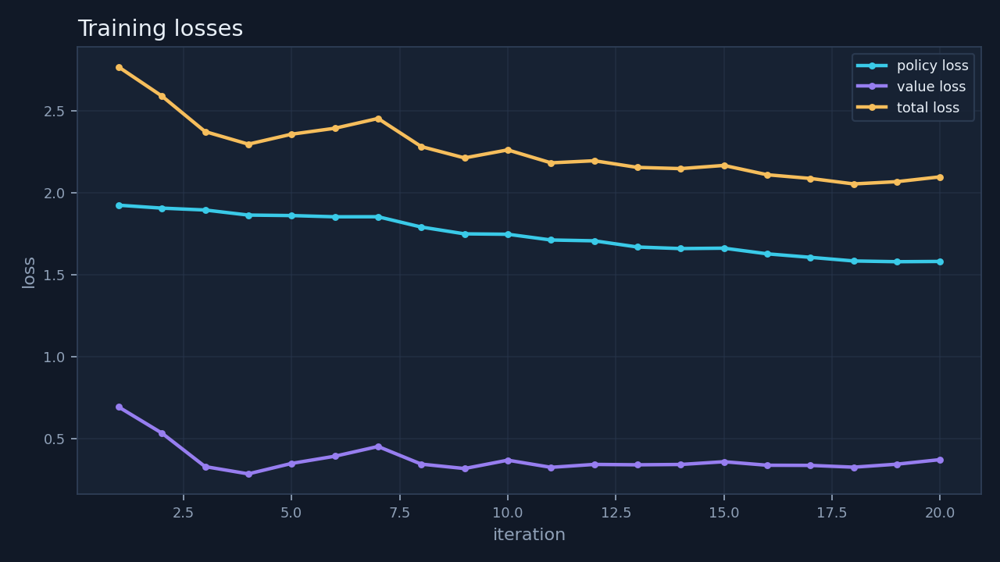

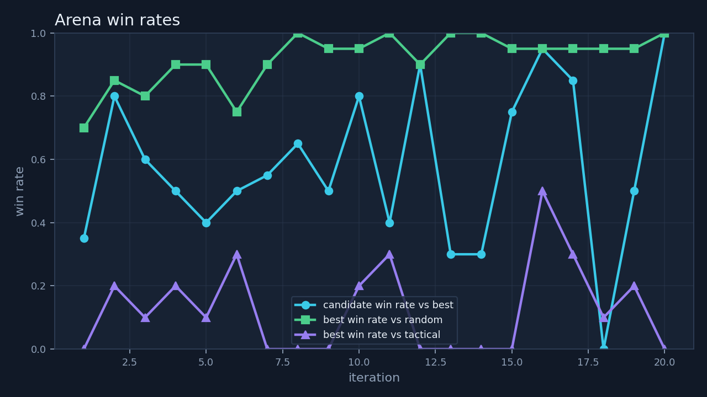

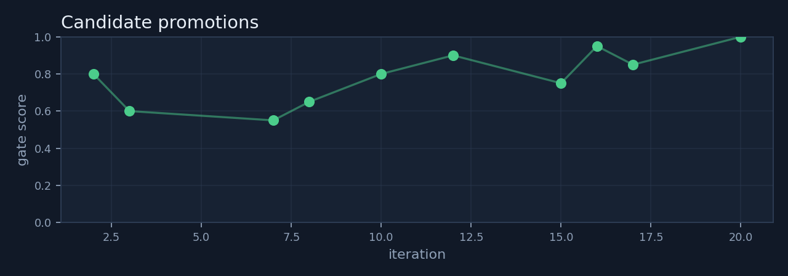

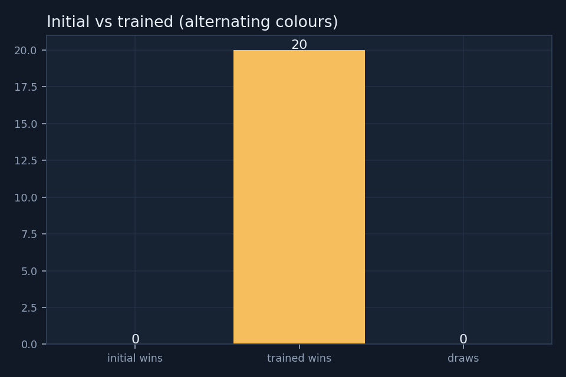

## How Training Works

1. The current best model plays complete games against itself through MCTS.
2. Root visit counts become policy targets. Final game outcomes become value targets, always from
   the perspective of the player to move at each position.
3. Examples enter the replay buffer.
4. A candidate network is initialized from the current best model and trained on replay samples.
5. The candidate plays the current best in alternating-color arena games.
6. If the candidate reaches the promotion threshold, it atomically replaces `best.pt`, while the
   previous best is retained as `best_previous.pt`.
7. Metrics, evaluation records, TensorBoard scalars, checkpoints, and the replay buffer are saved.

MCTS stores values from the perspective of the player to move at each node. A child's value is
therefore negated when selected by its parent. Search results in the UI use the AI's
current-player perspective: positive is good for the AI, negative is bad.

## Checkpoints and Artifacts

```text
checkpoints/<experiment>/
|-- initial.pt
|-- best.pt
|-- best_previous.pt
|-- latest.pt
|-- iteration_0001.pt
|-- ...
|-- replay_buffer.npz
|-- evaluation_history.json
`-- promotions.json

logs/<experiment>/
|-- metrics.jsonl
|-- status.json
|-- train.log
`-- tensorboard/

results/<experiment>/
|-- evaluations.json
|-- plots/
`-- selfplay/
```

`latest.pt` is the most recent candidate, not necessarily the best model. `best.pt` changes only
through arena promotion. The GUI labels both clearly.

## GUI Controls

- Main menu: keys `1`-`8`, mouse, `Esc` to exit.
- Human vs AI: click a column, `R` restart, `Esc` menu.
- AI vs AI: `Space` pause/resume, `S` swap colors, `R` restart, `Esc` menu.
- Checkpoint manager: mouse selection, wheel scroll, A/B marks, comparison.
- Training monitor: start, pause, resume, stop, resume from checkpoint, experiment selector.
- Evaluation dashboard: experiment selector, refresh, Matplotlib PNG export.
- Settings: MCTS budget, animation speed, saved UI preferences.

The `Esc` key returns to the previous or main screen depending on context. The AI search runs on a
background thread, so the Pygame event loop remains responsive.

## Configuration

`configs/default.yaml` contains the full configuration. `configs/fast_demo.yaml` overrides it with
the smaller CPU demonstration settings. Important groups:

- `model`: channels, residual blocks, input channels.
- `mcts`: simulations, PUCT constant, Dirichlet noise, temperature.
- `selfplay`: games per iteration, workers, temperature schedule.
- `training`: iterations, epochs, batch size, learning rate, replay capacity.
- `evaluation`: candidate/random/tactical game counts, simulations, promotion threshold.
- `paths`: checkpoint, log, and result roots.
- `ui`: window size, FPS, default search budget.

Changing a training configuration does not silently change the GUI's saved search budget.

## Tests

```powershell
python -m pytest -q
```

The current suite contains 62 passing tests covering game rules, observation perspectives, network
shapes, MCTS legality/visit accounting/backpropagation, self-play, replay persistence, training
losses and iterations, arena evaluation, typed evaluation history, reporting, and headless rendering
of every screen.

UI tests use `SDL_VIDEODRIVER=dummy` and do not require a visible desktop. The screenshot script
also runs headless.

## Limitations

- The demo run is deliberately small and CPU-friendly. It is evidence of a working learning
  pipeline, not a superhuman Connect Four agent.
- The tactical baseline is still stronger than the demo model in the recorded matchups.
- Search quality is limited by the MCTS budget. Increasing simulations at play time helps but
  cannot replace more training.
- Most of the code is CPU-first. CUDA is selected automatically when available, but a large GPU
  training run was not performed for the preserved demo.
- Screenshots are 1280x800 and target that window size. Rendering uses a fixed layout rather than
  a fully responsive scale.
